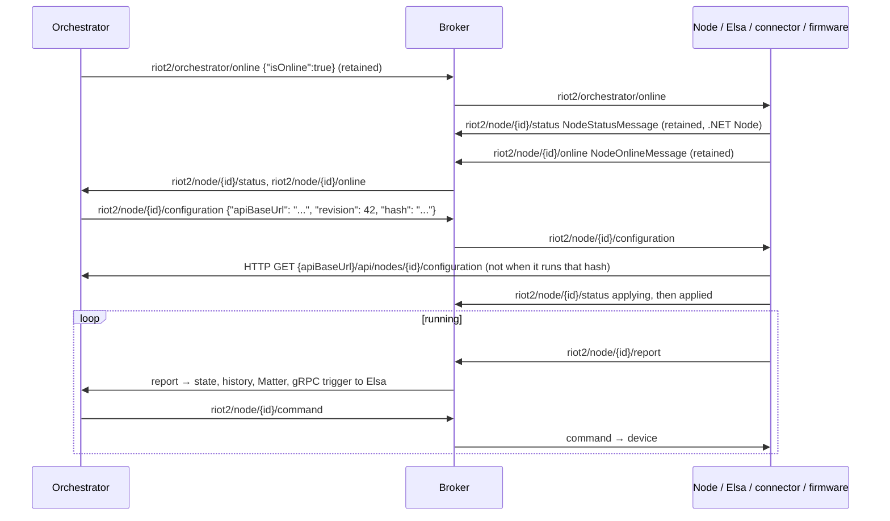

# MQTT lifecycle and delivery semantics

Applies to: every component that connects to the MQTT broker. Topics and payloads are in
[mqtt-topics.md](mqtt-topics.md); this file covers how participants find each other and what the
broker connection guarantees. Source of truth: `RIoT2.Core/Utils/MqttClient.cs`,
`RIoT2.Core/Services/NodeMqttService.cs`, `RIoT2.Net.Orchestrator/Services/OrchestratorMqttService.cs`
and `RIoT2.Ard.Shared/RIoT2Shared/src/MqttConnection.cpp`. If this document and the code disagree,
the code wins. Fix this document.

## Lifecycle

- The node also announces itself on every (re)connect, so the steps after the first one repeat
  whenever either side reconnects. From Node 1.5.0 the .NET Node sees that it runs the command's
  `hash`, answers with its status and fetches nothing; an older one fetches an identical
  configuration and restarts no device (Core `1.1.0`). The [end-to-end tests](https://github.com/Revolutionized-IoT2/RIoT2.Tests/blob/main/README.md#end-to-end-tests) check both.
- Presence and status are retained, so a restarted orchestrator knows every node's presence and
  configuration state at once. A .NET node started while the orchestrator is down runs its saved
  configuration ([configuration.md](configuration.md#desired-state)).
- Firmware reconnects with backoff, resubscribes, and publishes online again.
- .NET clients use the MQTTnet managed client, which reconnects after 5 s.

## Delivery semantics

| Aspect | .NET (`RIoT2.Core/Utils/MqttClient.cs`) | Firmware (`PubSubClient`) | UI (MQTT.js) |
|---|---|---|---|
| Publish QoS | 1 (Core 1.3.0; 2 before) | 0 | Library default (0) |
| Subscribe QoS | 1 (Core 1.3.0; 0 before) | 0 | Library default (0) |
| Effective delivery | **QoS 1** between .NET clients. The broker delivers at the lower of the two levels, so firmware still receives at QoS 0 | QoS 0 | QoS 0 |
| Outgoing queue | Up to 10,000 messages while the broker is unreachable; the oldest is dropped and logged when it is full | None | Library default |
| Session | Clean session | Clean session | `clean: true` |
| Last will | `riot2/node/{clientId}/online`, `{"name":"","isOnline":false,"nodeBaseUrl":""}`, retained from Core 1.8.0 (`NodeMqttService`; a bare `MqttClient` still defaults to not retained). Orchestrator: `riot2/orchestrator/online`, `{"isOnline":false}`, retained | Same topic, `{"isOnline":false}`, retained | Same topic, `{ "IsOnline": false }`, QoS 1, not retained |
| Transport | TCP `RIOT2_MQTT_PORT` (default 1883), no TLS | TCP 1883, or TLS 8883 (`mqttUseTls`, root CA) | `ws://…:9001/` |

Consequences:

- Between .NET clients, a message survives a dropped connection and can arrive twice. A message
  to or from firmware or the UI can still be lost.
- Commands go through the orchestrator's outbox (Orchestrator 1.4.0): in order per node, while it
  is online, until it answers or the time-to-live passes
  ([http-api.md](http-api.md#commands-commandscontroller-apiv2commands)). Before, commands to an
  offline node were lost.
- Orchestrator → Elsa triggers don't use MQTT. Each templated report becomes a trigger in the
  orchestrator's durable outbox and is delivered over gRPC at least once, in order, until its
  time-to-live passes (Orchestrator 1.3.0, [design 7.1](../design/reliable-delivery.md)). A trigger waits while no workflow node is
  online and survives an orchestrator restart.
- `NodeMqttService` publishes a node's reports in the order its devices raised them. At most
  **1,000** wait to be published; beyond that the oldest is dropped and logged.
- `NodeMqttService` allows at most **64** outstanding commands. Extra commands are rejected with a
  log warning, and answered `rejected` when they carry a `correlationId`, so the orchestrator sends
  them again. An MQTT acknowledgement does not mean that the device executed the command; a
  `CommandResult` does.
